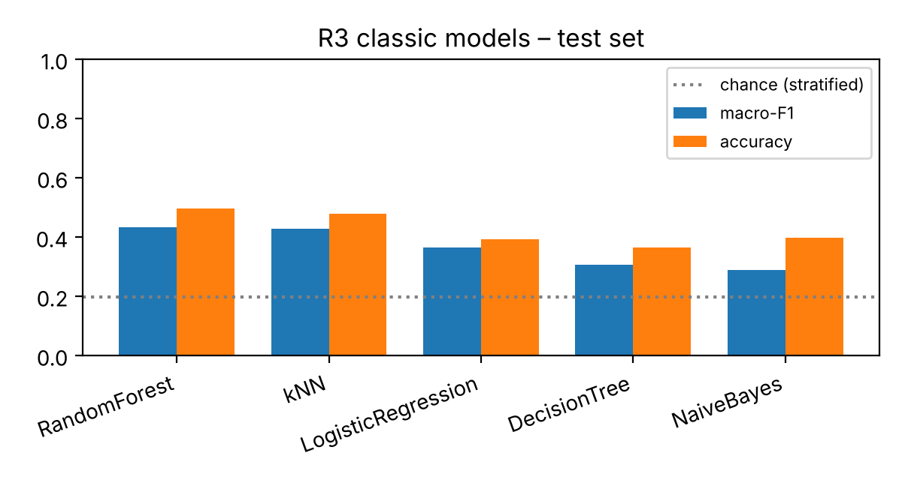

# Skin Disease Classification on Fitzpatrick17k: F20DL Group 15

**Course:** F20DL Data Mining and Machine Learning, Heriot-Watt University Dubai, 2026–27
**Group:** Group 15 (UG)
**Report:** [documentation/F20DL_Group15_Report.pdf](documentation/F20DL_Group15_Report.pdf)

We classify clinical photographs of skin into **5 conditions**: allergic contact dermatitis, basal cell carcinoma (BCC), psoriasis, seborrheic dermatitis and vitiligo. We compare classical machine-learning models (R3) with neural networks (R4) on one shared, cleaned dataset, and check how skin tone and image artefacts (a source watermark) affect the results.

## Team

| Member | Role |
|---|---|
| Abdullah Shaikh | Data lead: download, cleaning and split pipeline, data analysis and clustering (R2) |
| Adhil Mohamed | Classical models: Decision Tree, Random Forest (R3) |
| Abhinav Vijay | Classical models: kNN, Naive Bayes, Logistic Regression and R3 comparison (R3) |
| Arjun Rajkumar | Neural networks: MLP and CNN (R4) |
| Aditya Anoop Raj | Report lead: introduction, discussion, conclusion, report integration |

## Milestones

| Date | Milestone |
|---|---|
| 9 Oct 2026 | Project pitch (topic, dataset, task split) |
| 23 Nov 2026 | Image download and cleaning pipeline, shared train/val/test split |
| 24 Nov 2026 | R2 data analysis notebook; R3 decision tree and random forest |
| 24–25 Nov 2026 | R3 kNN, Naive Bayes, Logistic Regression and model comparison |
| 25 Nov 2026 | R4 MLP and CNN, watermark check |
| 26 Nov 2026 | Report submitted |

## Dataset

**Fitzpatrick17k** (Groh et al., 2021): https://github.com/mattgroh/fitzpatrick17k
**Licence:** Creative Commons Attribution-NonCommercial-ShareAlike 3.0 (CC BY-NC-SA 3.0).
Images come from two online dermatology atlases (DermaAmin and Atlas Dermatologico), and each image is annotated with a Fitzpatrick skin type (1 = very light … 6 = very dark).

We use 5 of its 114 conditions. The original CSVs (`data/<disease>.csv`) list 1,843 images; after downloading and cleaning, **1,623 images** remain.

| Disease (label_id) | Images | Train | Val | Test |
|---|---|---|---|---|
| Allergic contact dermatitis (0) | 381 | 267 | 57 | 57 |
| Basal cell carcinoma (1) | 355 | 248 | 53 | 54 |
| Psoriasis (2) | 604 | 423 | 91 | 90 |
| Seborrheic dermatitis (3) | 123 | 86 | 18 | 19 |
| Vitiligo (4) | 160 | 112 | 24 | 24 |
| **Total** | **1,623** | **1,136** | **243** | **244** |

**Two example records** from `data/dataset.csv`:

| file | label | label_id | is_malignant | fitzpatrick_scale | source_folder | split |
|---|---|---|---|---|---|---|
| images/allergic_contact_dermatitis/allergic_contact_dermatitis_0001.jpg | allergic contact dermatitis | 0 | 0 | 3 | allergic_contact_dermatitis | train |
| images/allergic_contact_dermatitis/allergic_contact_dermatitis_0002.jpg | allergic contact dermatitis | 0 | 0 | 1 | rhus_dermatitis | val |

## Repository layout

```
data/                     original Fitzpatrick17k CSVs, final dataset.csv, cleaning logs
scripts/
  download_images.py      downloads the images listed in the CSVs
  clean_and_split.py      removes mislabelled/duplicate images, makes the shared split
  load_data.py            shared loader used by every notebook
notebooks/                R2, R3 and R4 notebooks (run, outputs saved)
notebooks/results/        CSVs with validation searches and test scores
documentation/figures/    all figures used in the report
requirements.txt          exact package versions
```

## Installation

Tested with Python 3.13.

```bash
pip install -r requirements.txt
```

## Getting the data

The images are not stored in this repository (too large). There are two options.

**Option A: download the prepared data (fastest).**
Download `Fitzpatrick17k_processed.zip` from
[OneDrive](https://heriotwatt-my.sharepoint.com/:u:/r/personal/amas2001_hw_ac_uk/_layouts/15/onedrive.aspx?id=%2Fpersonal%2Famas2001%5Fhw%5Fac%5Fuk%2FDocuments%2FAbdullah%20Shaikh%2FUniversity%20Work%2FF21DL%20%2D%20Data%20Mining%20and%20Machine%20Learning%20%2D%202026%2D2027%2FFitzpatrick17k%5Fprocessed%2Ezip&parent=%2Fpersonal%2Famas2001%5Fhw%5Fac%5Fuk%2FDocuments%2FAbdullah%20Shaikh%2FUniversity%20Work%2FF21DL%20%2D%20Data%20Mining%20and%20Machine%20Learning%20%2D%202026%2D2027&share=cQqcI3vqKQ%2DTSKdCnihirCR4EgUDkii%2DeD47N9bSbh7poAZvGw)
(Heriot-Watt login) and unzip it into the **main repository folder**, so that `Fitzpatrick17k_processed/` sits next to `notebooks/`.

**Option B: rebuild it from the original source.**
```bash
cp data/allergic_contact_dermatitis.csv data/basal_cell_carcinoma.csv data/psoriasis.csv \
   data/seborrheic_dermatitis.csv data/vitiligo.csv scripts/
cd scripts
python download_images.py      # downloads ~1,670 images (DermaAmin links are rewritten to the site's new URLs)
python clean_and_split.py      # cleans and creates Fitzpatrick17k_processed/ with dataset.csv
```
Then move `scripts/Fitzpatrick17k_processed/` into the main repository folder and copy `scripts/load_data.py` into it. Some source links may have changed since November 2026, so the exact image count can differ slightly.

## Running the notebooks

Open each notebook in `notebooks/` and run all cells. Every notebook starts with the same cell, which finds the data folder and imports the shared loader:

```python
import os, sys
DATA_DIR = next(p for p in ["../Fitzpatrick17k_processed", "Fitzpatrick17k_processed"] if os.path.exists(p))
sys.path.append(DATA_DIR)
from load_data import load_split, load_info, CLASS_NAMES
```

## What each part does

**R2: Data analysis** ([notebooks/R2_data_analysis.ipynb](notebooks/R2_data_analysis.ipynb))
Documents the dataset, then cleans it: 39 images from source folders of a different disease (e.g. Grover's disease labelled as contact dermatitis), 1 image flagged by the dataset's own quality check and 6 near-duplicates (perceptual hash, confirmed pixel by pixel) were removed. The split is stratified 70/15/15 with seed 42. The analysis shows a 4.9× class imbalance, only 13% dark skin (types V–VI), and that 72% of BCC images come from the atlas whose photos carry an "SFS" watermark. k-means on raw pixels groups images by brightness, not by disease (ARI 0.002).

**R3: Classical models** ([notebooks/R3_decision_tree_random_forest.ipynb](notebooks/R3_decision_tree_random_forest.ipynb), [notebooks/R3_knn_nb_logreg.ipynb](notebooks/R3_knn_nb_logreg.ipynb))
Decision Tree, Random Forest, kNN, Gaussian Naive Bayes and Logistic Regression on 32×32 flattened pixels (3,072 features). Hyperparameters were tuned on the validation set with balanced class weights; the test set was used once. Includes per-class results, a skin-tone breakdown and a Random Forest feature-importance map, which shows a hot spot at the watermark corner.

**R4: Neural networks** ([notebooks/R4_mlp_cnn.ipynb](notebooks/R4_mlp_cnn.ipynb))
An MLP on the same 32×32 input as R3, and a small CNN trained from scratch on 128×128 images. Both use class-weighted cross-entropy, Adam and early stopping on validation macro-F1. They are compared with the best R3 model using a bootstrap, plus a watermark check that covers the image corner and re-predicts.

## Results (test set, 244 images)

| Model | Macro-F1 | Accuracy |
|---|---|---|
| CNN (R4) | **0.464** | 0.488 |
| MLP (R4) | 0.452 | 0.492 |
| Random Forest (R3) | 0.433 | 0.496 |
| kNN (R3) | 0.428 | 0.480 |
| Logistic Regression (R3) | 0.363 | 0.393 |
| Decision Tree (R3) | 0.307 | 0.365 |
| Naive Bayes (R3) | 0.289 | 0.398 |
| Chance (stratified) | 0.197 | 0.242 |

The CNN's gain over Random Forest (+0.037 macro-F1) is not statistically clear (bootstrap 95% CI −0.043 to +0.115). Covering the watermark corner lowers BCC recall for Random Forest and the MLP, but not for the CNN.



## References

- M. Groh et al., "Evaluating Deep Neural Networks Trained on Clinical Images in Dermatology with the Fitzpatrick 17k Dataset," CVPR Workshops, 2021.
- K. Abhishek, A. Jain, G. Hamarneh, "Investigating the Quality of DermaMNIST and Fitzpatrick17k Dermatological Image Datasets," Scientific Data, vol. 12, art. 196, 2025.
